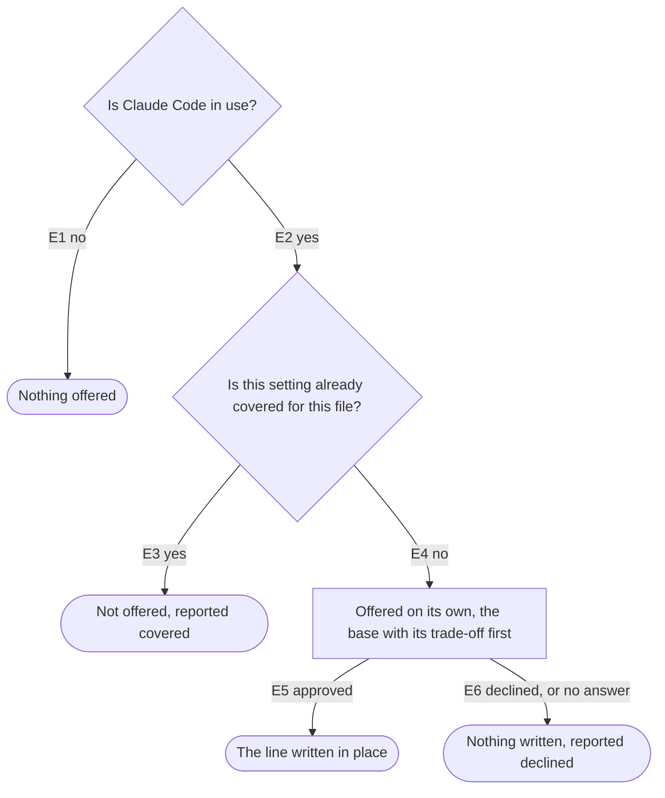

# Agent-worktree settings: decision graph

Asked once per run at `inuse`, then once per setting and file. No setting's answer changes another's path.

- Outcomes: `none`, `covered`, `written`, and `declined`.
