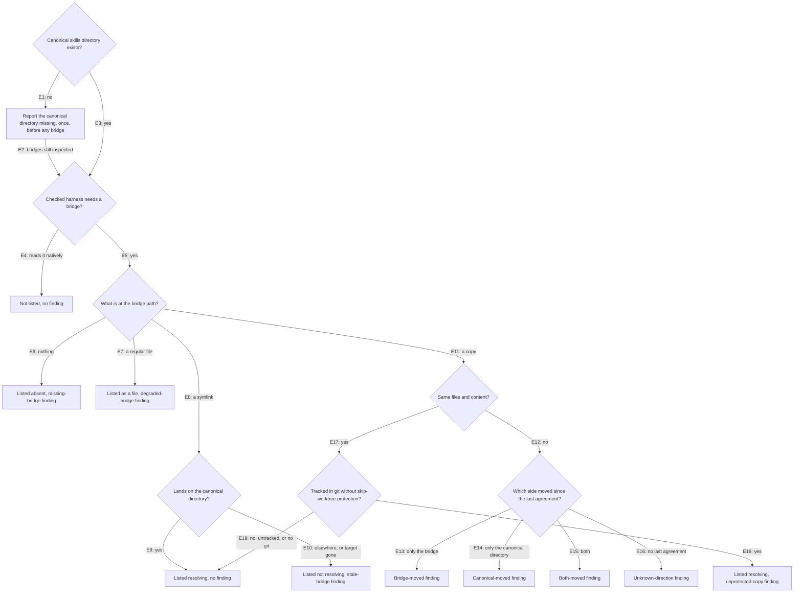

# Bridge resolution: decision graph

Each checked harness is judged on its own from `D2` onward. No branch writes. A branch that cannot tell reports the
"cannot tell" outcome rather than guessing.

