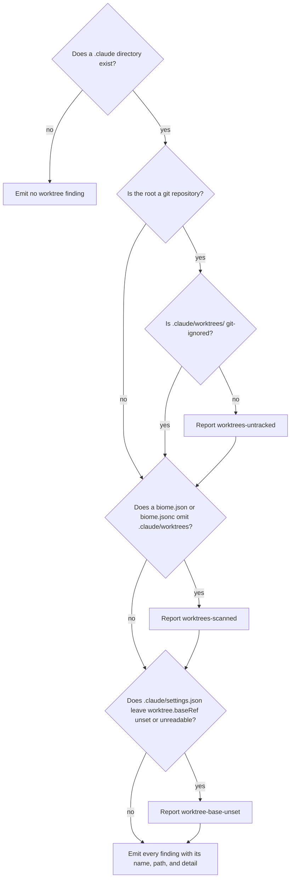

# worktree-diagnosis

## What

The `doctor` command's report on **agent worktrees**: whether a repository worked in with Claude Code accounts for the checkouts Claude Code creates inside it.

Claude Code runs a session started with `--worktree`, and a subagent isolated in a worktree, in a git worktree under `.claude/worktrees/<name>/` at the repository root. Each one is a whole checkout inside the repository, config files included. A repository that does not account for that pays in three ways, and each is a finding: `git status` lists the directory as untracked, a tool that walks the tree finds every worktree's own config, and agent worktrees branch from the default branch rather than from the current `HEAD`.

It exists so that **detection has one home**, the same property `../../workflows/detect-and-repair/` owns for every family. This family is **uniform in its owner**: every fault repairs through the `init-buddy-agent-harness` skill, or through the `enhance` skill where the repository already has an `AGENTS.md`, because both offer the lines and neither runs without approval. None of them repairs through `repair`, and none carries a runnable command.

**Non-goals**

- **Repairing.** The command never writes. Each finding carries the repair as text. The offers, the explanation of the base trade-off, and the approved writes are `../../skills/init-buddy-agent-harness/` and `../../skills/enhance/`.
- **Offering a command for a fault here.** Every fault is a line in a file the owner wrote or may want to leave alone, so correcting one is judgment. Each repair has an empty command.
- **Moving the worktrees.** The place is Claude Code's, and no setting moves it. Nothing here suggests otherwise.
- **Harnesses other than Claude Code.** Every check requires a `.claude` directory, so a repository that does not use Claude Code is never reported.
- **The shape of the report.** Which sections exist and what a finding row carries is `../diagnosis-report/`.
- **Reporting an explicit choice.** A `worktree.baseRef` of `"fresh"` is the owner's answer and is not a fault.

**Key terms**

- **agent worktree** — a git worktree Claude Code creates under `.claude/worktrees/<name>/` for a `--worktree` session or an isolated subagent.
- **worktree fault** — one named way a repository leaves its agent worktrees unaccounted for: `worktrees-untracked`, `worktrees-scanned`, `worktree-base-unset`.
- **base** — the commit an agent worktree branches from. Unless `worktree.baseRef` is `"head"`, Claude Code branches from the repository's default branch.

## Use Cases

**Actors**

- **`init-buddy-agent-harness` skill** — offers the repair for each finding; the consumer the repair names first.
- **`enhance` skill** — offers the same repair where the repository already has an `AGENTS.md`.
- **person at a shell** — reads the finding and decides whether to take the offer.
- **session-start hook** — runs the command unattended on every session; the reason the command must never write.
- **`doctor-buddy-agent-harness` skill** — presents the report and routes each finding to `init` or `enhance`.

**Goals, and where each is served**

| Actor | Goal | Entry point |
| --- | --- | --- |
| `init-buddy-agent-harness` and `enhance` skills | know which worktree lines are missing without detecting anything themselves | `buddy-agent-harness doctor` |
| person at a shell | see what is missing and which skill offers it | `buddy-agent-harness doctor --format text` |
| session-start hook | learn of a fault without any risk of a write | `buddy-agent-harness doctor` |

**Entry point**

| Entry point | Trigger | Inputs | Outcome |
| --- | --- | --- | --- |
| `buddy-agent-harness doctor` | a caller asks what is wrong with this repository's agent configuration | the repository root | every worktree fault reported alongside the other findings, each carrying its `problem` name, its `path`, and a `detail` in prose, with a repair whose instruction names both skills |

**Surface**

This capability adds **no new option**. It reports through the existing `findings` and `help` sections and honors `--root` and `--format`.

The three faults and the file each names:

| Problem | Path | Reported when |
| --- | --- | --- |
| `worktrees-untracked` | `.gitignore` | `.claude/worktrees/` is not git-ignored. A rule on a parent directory counts as ignoring it. |
| `worktrees-scanned` | `biome.json` or `biome.jsonc` | the config does not mention `.claude/worktrees` |
| `worktree-base-unset` | `.claude/settings.json` | `worktree.baseRef` is unset, the file has no `worktree` key, the file does not parse, or the file is missing |

Every repair has an empty command and an instruction that names **both** the `init-buddy-agent-harness` skill and the `enhance` skill. None names `repair`. The repair is two fields for the reason stated in `../configuration-diagnosis/`: the caller routes on whether it may act, and an empty command says it may not.

**Extensions**

- **No `.claude` directory.** Nothing is reported. A repository that does not use Claude Code has no agent worktrees to account for.
- **The repository is not a git repository.** No ignore rule can be read, so `worktrees-untracked` is not reported rather than guessed at. The other two checks still run.
- **The settings file does not parse, or does not exist.** Reported as `worktree-base-unset`, since no base can be read from it.
- **A `worktree.baseRef` of `"fresh"`.** Left alone. It is the owner's choice, and reporting it would ask them to undo it.
- **A repository with no Biome config.** No `worktrees-scanned` finding. Other tools that walk the tree are offered by the skills, not detected here.

## Control Flow

Each check is independent, so one run reports as many faults as it finds. No check writes, and a check that cannot answer reports nothing rather than guessing.

## Scenario map

### `buddy-agent-harness doctor`

| Edge | Path (Given) | Scenario |
| --- | --- | --- |
| A→H | a repository that ignores the worktrees and sets the base | `reports nothing for a repository that ignores the worktrees and sets the base` |
| A→J | no `.claude` directory | `reports nothing where no .claude directory exists` |
| C→C1 | a `.gitignore` without the rule | `reports a repository whose .gitignore leaves .claude/worktrees/ tracked` |
| C→D | a rule on a parent directory | `accepts a rule on a parent directory` |
| B→D | not a git repository | `reports nothing outside a git repository, where no rule can be read` |
| D→E | a `biome.json` without the exclusion | `reports a biome.json that does not exclude the worktrees` |
| D→E | a `biome.jsonc` without the exclusion | `reports a biome.jsonc the same way` |
| D→F | a `biome.json` with the exclusion | `accepts a biome.json that excludes the worktrees` |
| F→G | no settings file | `reports a .claude directory with no settings file` |
| F→G | unparseable settings | `reports settings that do not parse, since no base is read from them` |
| F→G | a `worktree` key with no `baseRef` | `reports settings that leave worktree.baseRef unset` |
| F→G | no `worktree` key | `reports settings with no worktree key` |
| F→H | an explicit `"fresh"` | `leaves an explicit "fresh" alone, since it is the owner's choice` |
| C1, E, G | all three faults at once | `reports all three at once` |
| H | a reported fault | `carries an empty command and names both skills in every repair` |

## References

- `../../../../src/diagnose-bridges/doctor-guidance.ts` holds `worktreeTable`, the table both the command's report and the shipped `doctor-buddy-agent-harness` skill's `references/worktrees.md` are generated from.
- `../../../../skills/init-buddy-agent-harness/references/agent-worktrees.md` backs the three faults: where Claude Code puts agent worktrees, what each fault costs, and how each line is judged covered.
