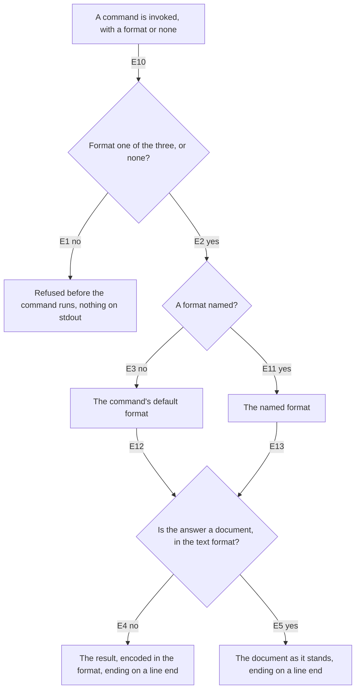
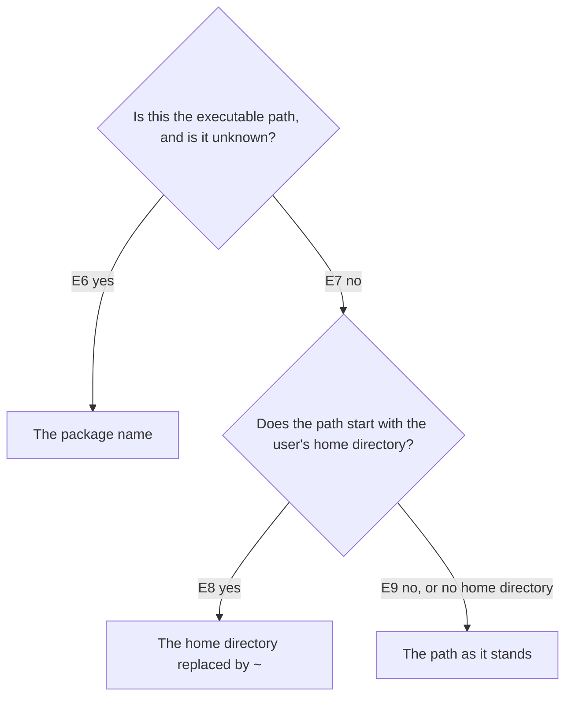
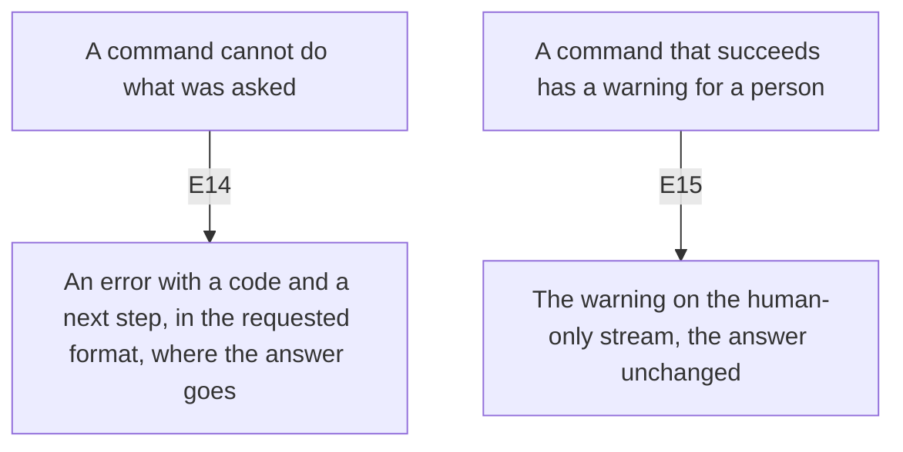

# Command output: decision graph

Two graphs that never meet. A path is put in pasteable form before the result is built, so it is a value in the
result like any other, and nothing that encodes a result looks for a path.

## Writing an answer

## Preparing a path

## Failing or warning

