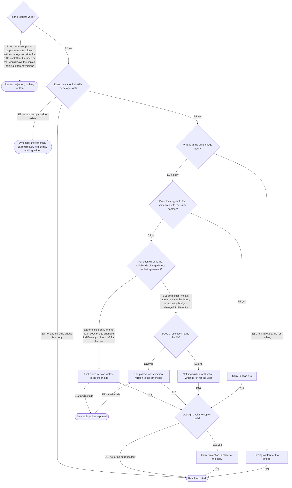

# copy-sync decision graph

The decisions one sync makes, as a caller can observe them. The branch from `bridge` is taken once for each skills
bridge path, and the branch from `side` once for each file that differs between a copy bridge and the canonical
skills directory.

- Outcomes: `rejected`, `missing`, `failed`, and `result`.
