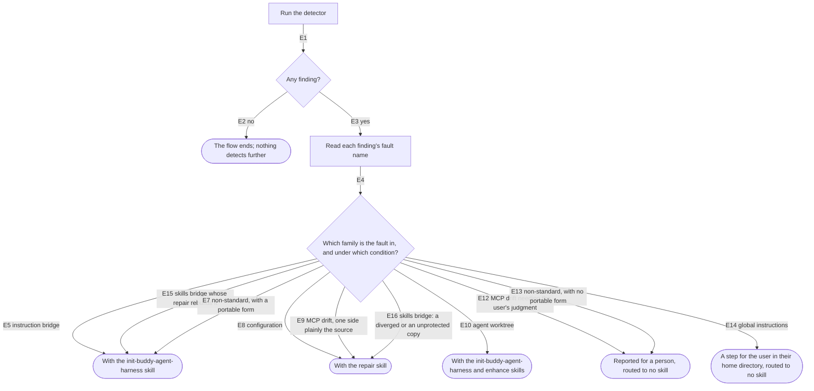

# Detect and repair: decision graph

How a finding travels from the detector to its owner. Nodes are decisions a consumer can observe. Every leaf is an
outcome, and each criterion in [README.md](./README.md) cites the edges it constrains.

E6 and E11 are retired. Routing reads the fault name only. No edge reads the prose description, and no edge writes.
