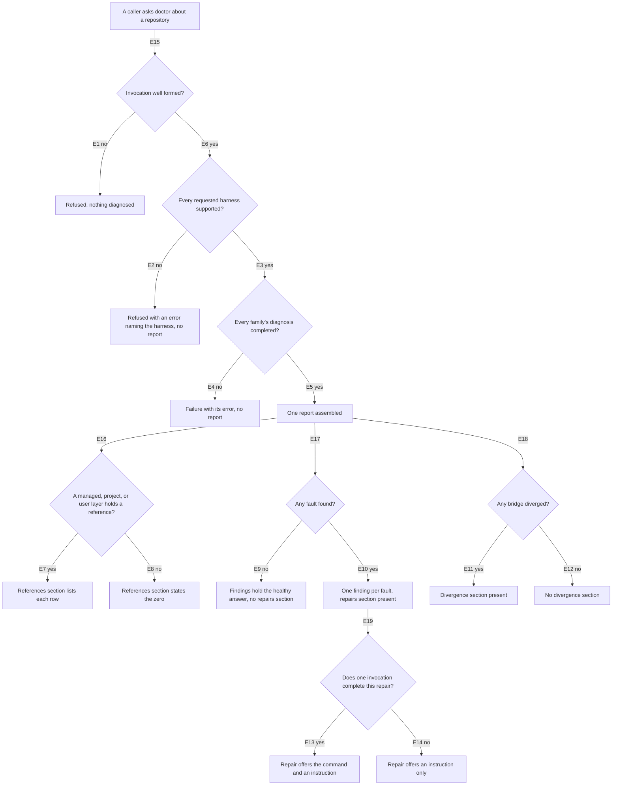

# Diagnosis report: decision graph

The decisions one `doctor` run makes that a consumer can observe. The report's decisions after `A` are independent:
each sets one part of the same report.

E1 is the format refusal [command-output](../command-output/README.md) owns; this spec cites it only
for the outcome a hook tells apart (R26).
