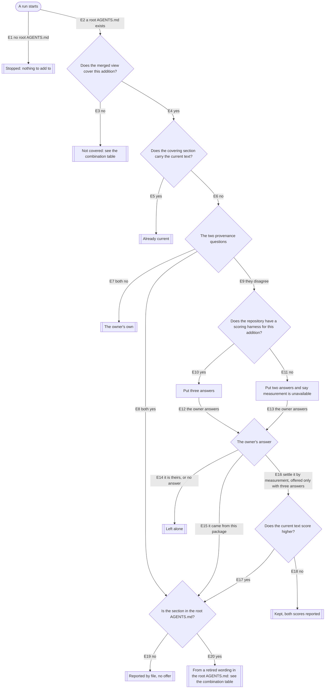
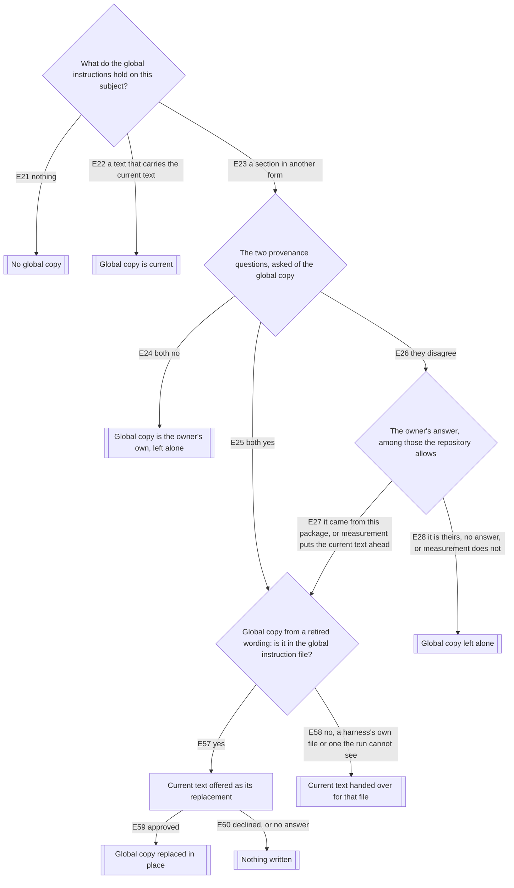
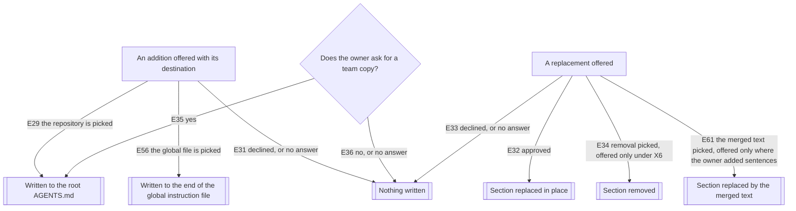
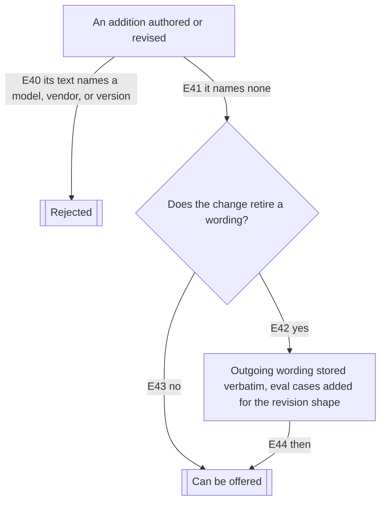

# enhance-buddy-agent-harness: decision graph

The decisions the [enhance-buddy-agent-harness spec](./README.md) makes, as an observer sees them. A run judges each addition twice: its
section in the repository (the repository graph) and any copy in the global instructions (the global-copy graph). The
combination table says what the two verdicts together offer. Double-bordered nodes are outcomes.

## A repository section

Asked once per addition. `start` is shared by every addition of a run.

## A global copy

Asked once per addition, of the global instructions, whatever the repository graph decided.

## Combination table

The repository verdict and the global-copy verdict together decide what is offered for the repository. A covered
repository verdict beside no global copy, or beside the owner's own or an unplaced one, takes the repository outcome
alone, except as X8 says.

| ID | Repository | Global copy | What the run does |
| --- | --- | --- | --- |
| X1 | not covered | none | the addition is offered (offer graph) |
| X2 | not covered | current | already global: nothing offered; a team copy is the owner's to ask for |
| X3 | not covered | the owner's own, from a retired wording, or unplaced | no repository offer; the global copy takes its own outcome; a team copy is the owner's to ask for |
| X4 | already current | current | nothing offered; the duplicate is named |
| X5 | from a retired wording in the root `AGENTS.md` | none, the owner's own, or unplaced | the replacement is offered |
| X6 | from a retired wording in the root `AGENTS.md` | current | the replacement is offered, with removal as the other answer |
| X7 | the owner's own | current | nothing offered; both are named, and the owner loads the subject twice |
| X8 | any covered verdict | from a retired wording | the repository row applies as if there were no global copy, and the global copy takes its own outcome |

## Offers and writes

## Whether the harness in use loads the global file

Read from `doctor`'s report for the harness in use, when an offer names the global destination. D4 holds whatever
else the report says.

| ID | `doctor` reports for the harness in use | The offer |
| --- | --- | --- |
| D1 | it loads the global instruction file | says so; no bridging step |
| D2 | it does not load it, through a missing or unbridged user-scope file | says the text reaches no session until it does; hands over the bridging step |
| D3 | it reads another file in place of its user-scope file | says so; hands over moving that file's content into the global file and removing it |
| D4 | its user-scope location comes from an empty variable | says the location changes with each directory; hands over unsetting the variable |
| D5 | nothing | says the load cannot be confirmed |
| D6 | it cannot load a file, keeping its user rules outside one | says the text reaches it only pasted into its user rules; hands over that step |

## Shipping an addition

E50 to E55 are retired: the agent-worktree offers moved to
[agent-worktree-settings](../agent-worktree-settings/graph.md). A retired edge ID is never reused.
