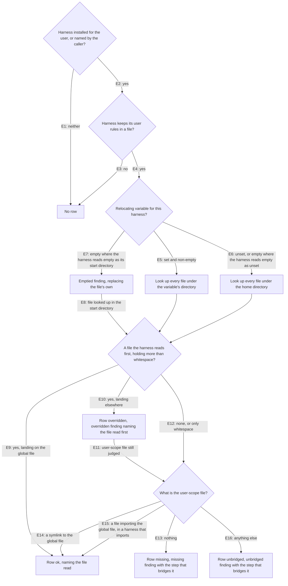

# Global instructions: decision graph

Each harness is judged on its own. No branch writes. A row is reported on every path from `D3`; a finding is raised
only when the global instruction file exists (`global-instructions` R21), so the outcomes below name the row and the
finding that row gets when the global file exists.

