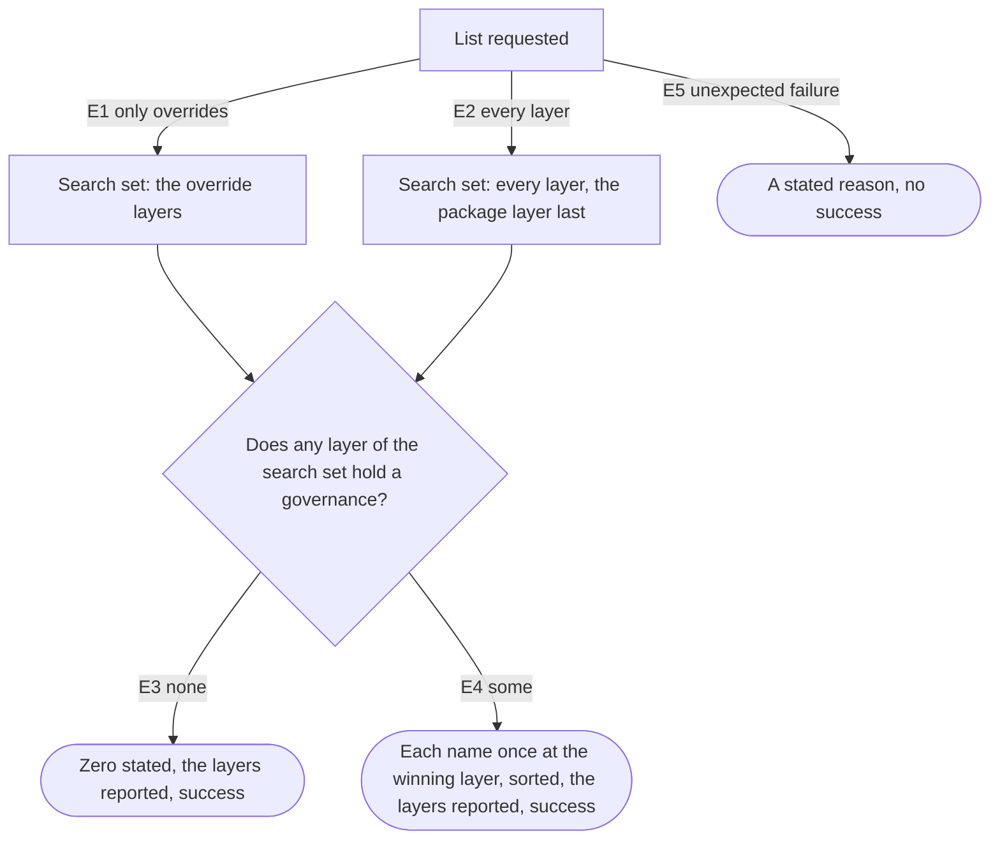
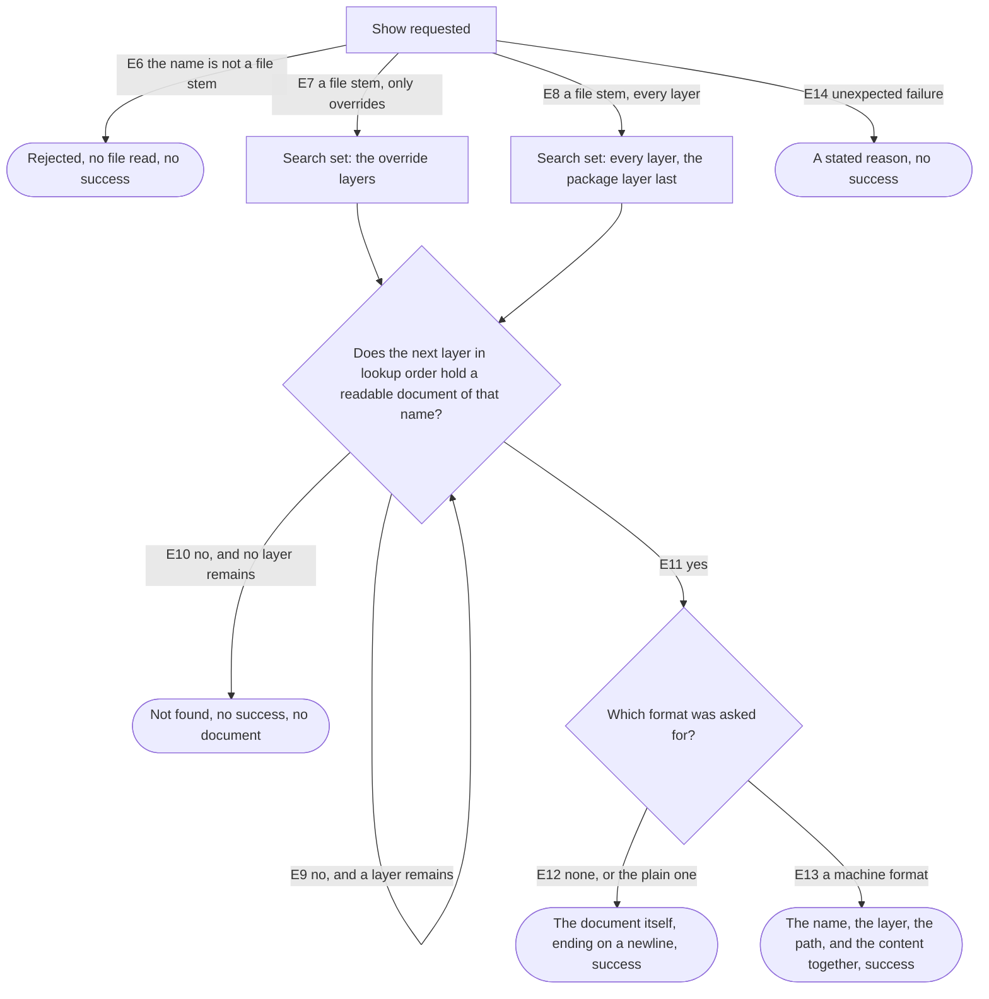

# Decision graph: governance-overrides

Two entry points share the layers in lookup order and nothing else: listing never reads a document, and showing
never reads a whole layer.

## Listing what the layers hold

## Showing one governance

