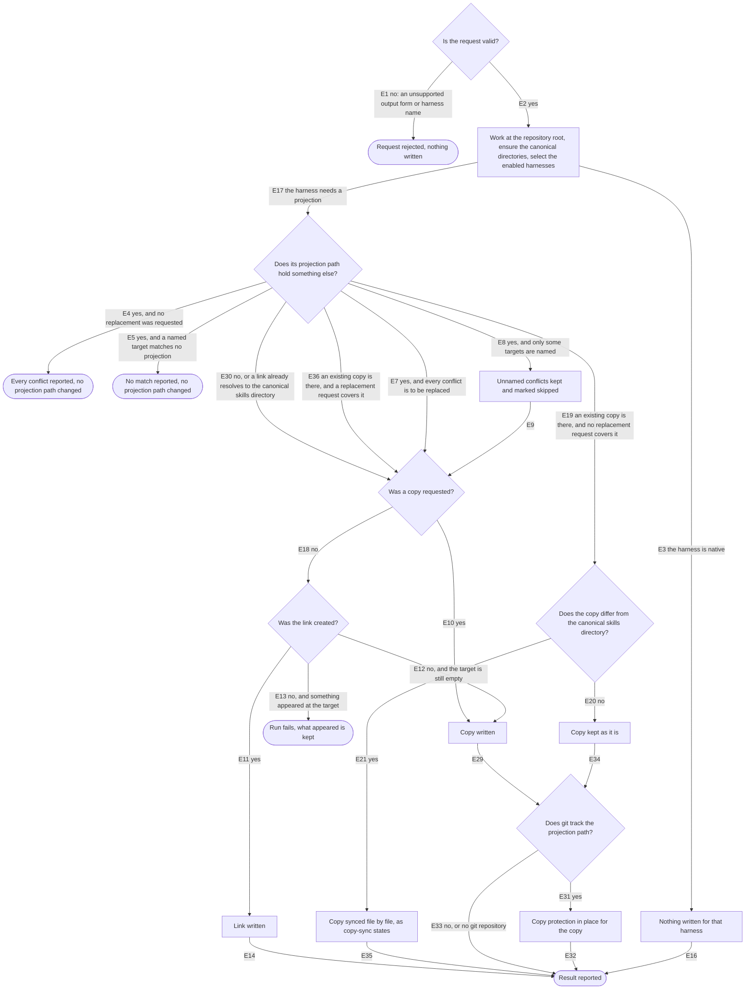

# harness-init decision graph

The decisions one run of the `init` command makes, as a caller can observe them. The branch from `scaffold` is taken
once for each enabled harness.

- E1 to E5, E7 to E14, E16 to E21, and E29 to E36 are the edges above. E6, E15, and E22 to E28 are retired: the sync's
  own decisions moved to [copy-sync](../copy-sync/graph.md). A retired edge
  ID is never reused.
- Outcomes: `rejected`, `reported`, `nomatch`, `failed`, and `result`.
