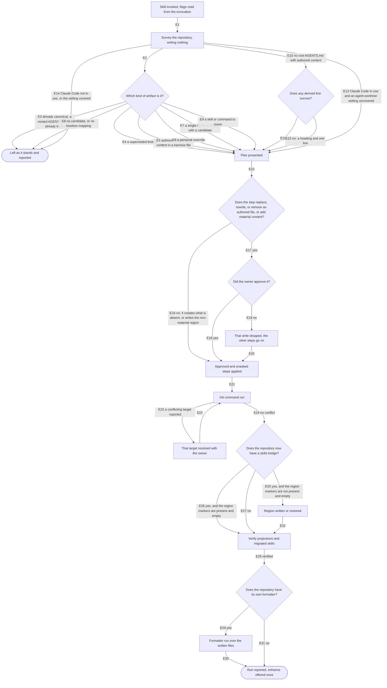

# init-buddy-agent-harness decision graph

The decisions one run of the skill makes, as the owner and a reviewer of the result can observe them. The branch at
`classify` is taken once for each artifact the survey finds, and the branch at `step` once for each step of the plan.

- Outcomes: `left` and `done`.
- The instruction bridge for Gemini CLI and the approved removals are steps of `apply`; whether each needs approval is
  decided at `step`.
