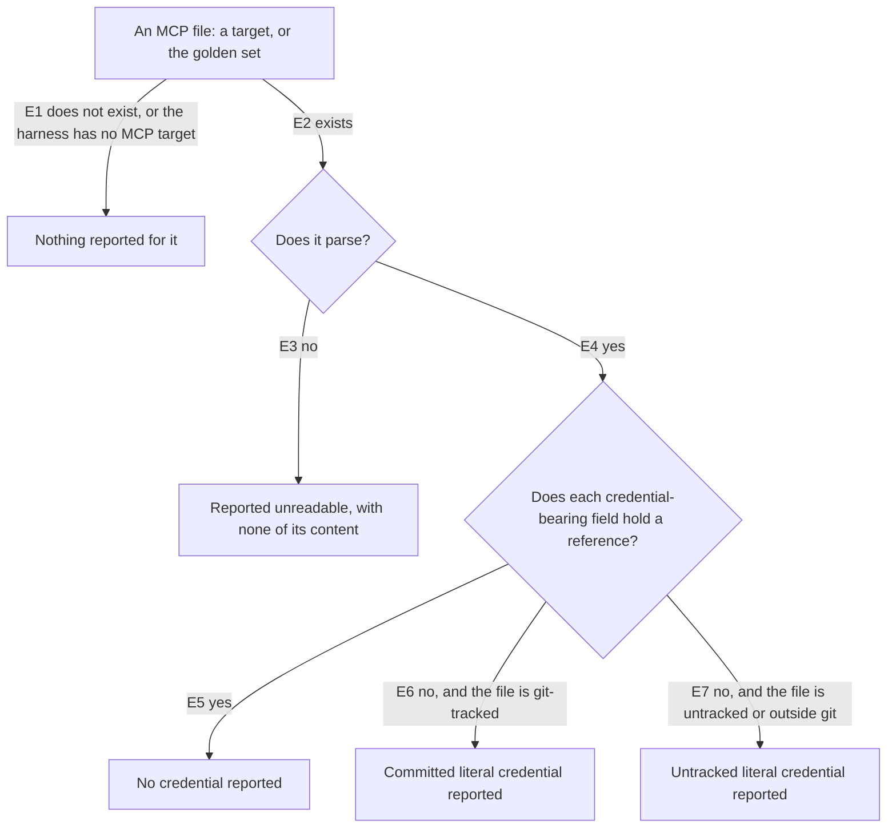
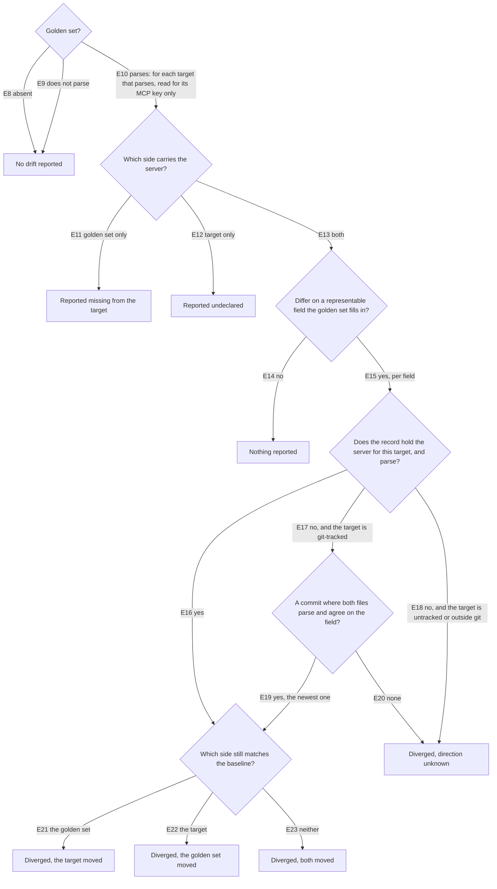

# MCP diagnosis: decision graph

Two independent checks. The credential check runs on every MCP file. The drift check runs only where a golden set
parses.

## Each MCP file: every MCP target and the golden set

## Drift against the golden set

