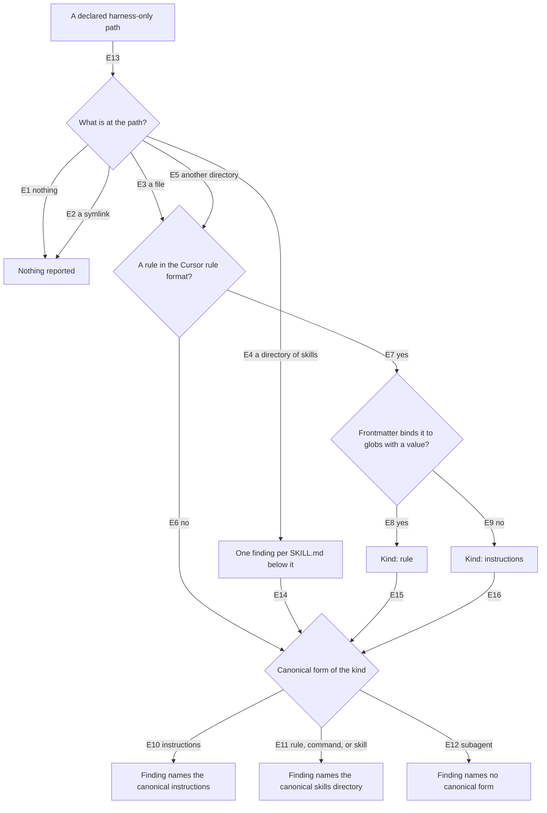

# Nonstandard configuration: decision graph

Every path the package declares as read by one harness only goes through this graph. A path two harnesses declare
goes through it once. Whether the harness is enabled is never asked.

E5 yields one finding per file below the directory, each under the directory's declared kind.
