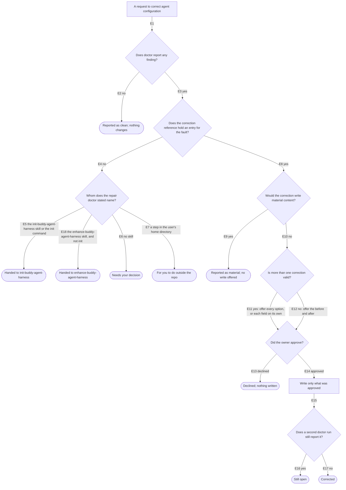

# repair-buddy-agent-harness: decision graph

The path of one run, and of each finding within it. The part from `Each` down runs once per finding, so one run can
hand one finding on, report a second as material, and correct a third. Every leaf is an outcome, and each criterion
in [README.md](./README.md) cites the edges it constrains.

The run holds no state of its own, so there is no first-run path.
