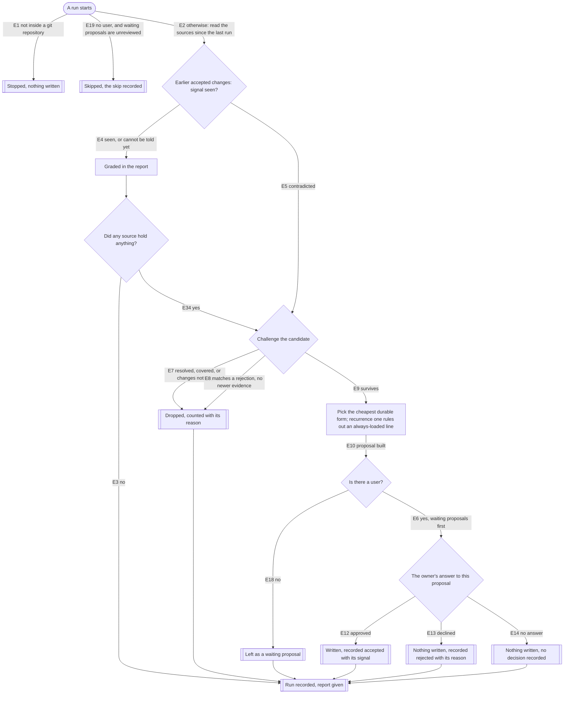
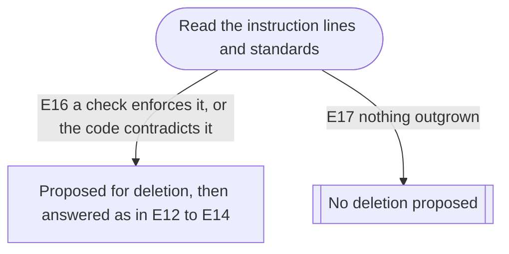
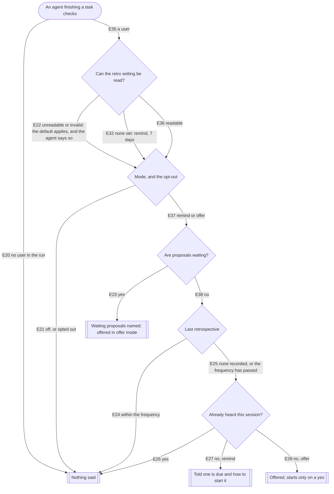
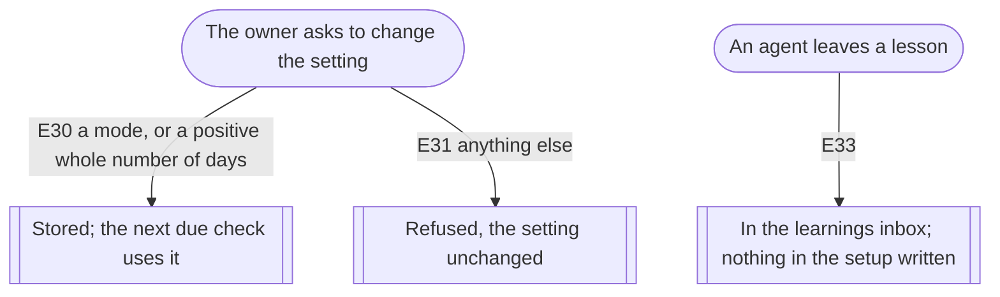

# retro: decision graph

The decisions the [retro spec](./README.md) makes, as an observer sees them. Double-bordered nodes are outcomes.

## A retrospective

`start` is shared by an attended run (UC1) and an unattended one (UC6). The candidate steps repeat per candidate.

## The prune pass

Part of every attended run (UC2), before the report.

## The due check

UC3. Nothing on this graph writes a file.

## Changing the setting, leaving a lesson

