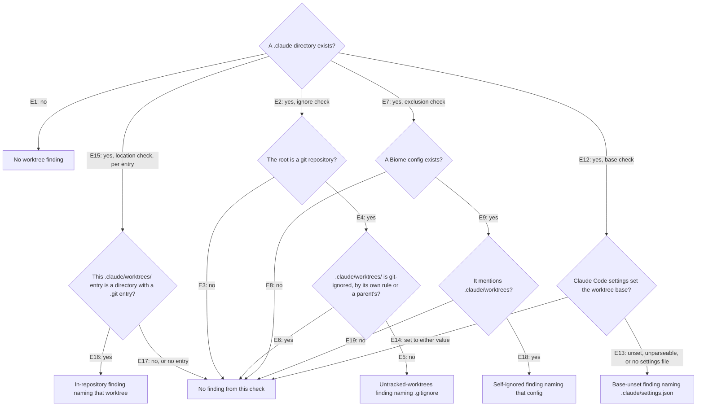

# Worktree diagnosis: decision graph

The checks after `D1` are independent: each runs whatever the others find, so one run can report every fault. No check
writes, and a check that cannot answer reports nothing rather than guessing.

- E10 and E11 are retired: the check for a missing Biome exclusion became the self-matching check, E18 and E19. A
  retired edge ID is never reused.
