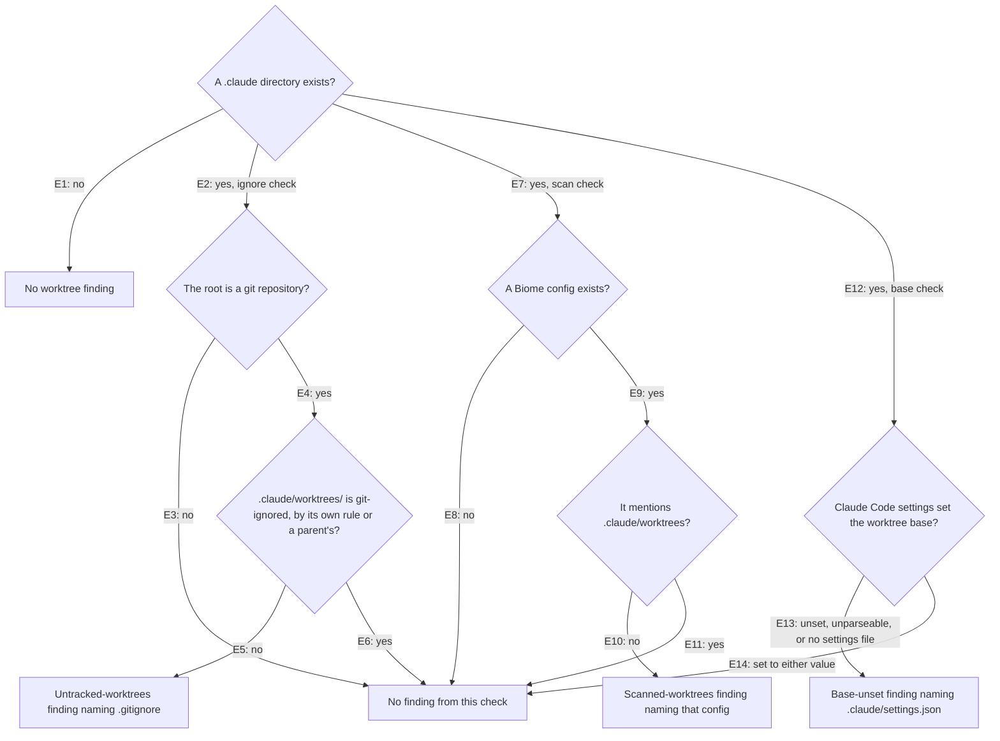

# Worktree diagnosis: decision graph

The three checks after `D1` are independent: each runs whatever the others find, so one run can report all three
faults. No check writes, and a check that cannot answer reports nothing rather than guessing.

